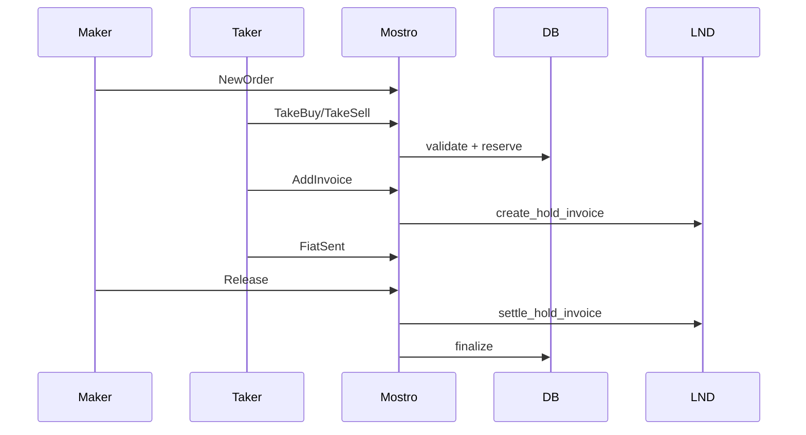

# Orders and Actions

Summary of order lifecycle and key handlers.

## Core Types
- Messages/Actions: `mostro_core::message::{Message, Action}`
- Orders: `mostro_core::order::Order` persisted via `mostro_core::db::Crud`.

## Handlers (entries)
- New Order: `src/app/order.rs`
- Take Buy: `src/app/take_buy.rs:11`
- Take Sell: `src/app/take_sell.rs`
- Add Invoice: `src/app/add_invoice.rs:21`
- Fiat Sent: `src/app/fiat_sent.rs`
- Release: `src/app/release.rs:94`
- Cancel: `src/app/cancel.rs`
- Dispute: `src/app/dispute.rs`
- Rate User: `src/app/rate_user.rs`
- Orders List: `src/app/orders.rs`
- Trade Pubkey: `src/app/trade_pubkey.rs`
- Restore Session: `src/app/restore_session.rs`

## Action → Handler Map

| Action | Handler File | Responsibility |
| --- | --- | --- |
| `new-order` | https://github.com/MostroP2P/mostro/blob/main/src/app/order.rs | Validate and create a new order; emit listing event |
| `take-buy` | https://github.com/MostroP2P/mostro/blob/main/src/app/take_buy.rs#L12 | Taker accepts sell; validate status, set amounts, reserve |
| `take-sell` | https://github.com/MostroP2P/mostro/blob/main/src/app/take_sell.rs | Taker accepts buy; mirror of take-buy for sell side |
| `add-invoice` | https://github.com/MostroP2P/mostro/blob/main/src/app/add_invoice.rs#L34 | Store buyer invoice or create hold invoice; notify parties |
| `fiat-sent` | https://github.com/MostroP2P/mostro/blob/main/src/app/fiat_sent.rs | Buyer signals fiat transfer; move to FiatSent |
| `release` | https://github.com/MostroP2P/mostro/blob/main/src/app/release.rs#L160 | Seller releases; settle hold invoice and finalize |
| `cancel` | https://github.com/MostroP2P/mostro/blob/main/src/app/cancel.rs#L319 | Cancel pending order; cancel hold if present |
| `dispute` | https://github.com/MostroP2P/mostro/blob/main/src/app/dispute.rs#L141 | Open dispute and notify admin/solver |
| `rate-user` | https://github.com/MostroP2P/mostro/blob/main/src/app/rate_user.rs | Record post-trade reputation update |
| `orders` | https://github.com/MostroP2P/mostro/blob/main/src/app/orders.rs | Return order lists/history to requester |
| `export-reputation` | https://github.com/MostroP2P/mostro/blob/main/src/app/reputation/export.rs | Check eligibility, sign a reputation attestation of the native figures, and return it once the account is bound to the destination identity (compare-and-set) |
| `import-reputation` | https://github.com/MostroP2P/mostro/blob/main/src/app/reputation/import.rs | Verify an issuer's reputation attestation, record the import and merge it into the identity's reputation (see [REPUTATION_PORTABILITY.md](REPUTATION_PORTABILITY.md)) |
| `trade-pubkey` | https://github.com/MostroP2P/mostro/blob/main/src/app/trade_pubkey.rs | Exchange or update per-trade pubkeys |
| `restore-session` | https://github.com/MostroP2P/mostro/blob/main/src/app/restore_session.rs | Rehydrate client session and state |
| `admin-cancel` | https://github.com/MostroP2P/mostro/blob/main/src/app/admin_cancel.rs | Admin cancel; optionally cancel hold invoice. Assigned solver must have `read-write` permission |
| `admin-settle` | https://github.com/MostroP2P/mostro/blob/main/src/app/admin_settle.rs | Admin settlement; settle/cancel holds, finalize. Assigned solver must have `read-write` permission |
| `admin-add-solver` | https://github.com/MostroP2P/mostro/blob/main/src/app/admin_add_solver.rs | Register dispute solver key. `admin-add-solver` accepts a bare pubkey (defaults to read-write), `pubkey:read`, `pubkey:write` (alias for read-write), or `pubkey:read-write`; see the parser in `admin_add_solver.rs` for the accepted forms |
| `admin-take-dispute` | https://github.com/MostroP2P/mostro/blob/main/src/app/admin_take_dispute.rs | Assign or take ownership of dispute |
| `admin-order-info` | https://github.com/MostroP2P/mostro/blob/main/src/app/admin_order_info.rs | Return the real state of any order of the node (`order_info` payload) to the admin or a solver; read-only. See [Admin order info](#admin-order-info) |
| `last-trade-index` | https://github.com/MostroP2P/mostro/blob/main/src/app/last_trade_index.rs | Retrieve user's last trade index from database |
| `user-info` | https://github.com/MostroP2P/mostro/blob/main/src/app/user_info.rs | Return the requester's own reputation (`user_info` payload) to the trade key; zeros for an unknown identity, `reputation_identity_required` without an identity proof |

## Admin order info

`admin-order-info` lets the admin or a solver ask for the real state of one order of the node. The public order event (kind 38383) only says `pending`, `in-progress`, `success` or `canceled`, and `orders` only answers for the caller's own orders; this action answers for any order, with what the database holds and what the Lightning node reports at that moment. It is read-only and idempotent, so a client may retry it.

**Request and reply.** Both travel in the `order` wrapper. The request carries the order id in `id` and no payload. The reply has the same `id` and `request_id` and an `order_info` payload (`mostro_core::order_info::OrderInfo`), sent to the trade key that asked. A request that carries a payload is dropped at intake.

**Who may ask.** The Mostro admin key and any registered solver, `read` or `read-write`, for any order, with or without a dispute. The check runs against the identity key and before the order is looked up. Anyone else gets `cant-do` `invalid_pubkey`; an unknown order id gets `not_found`.

**What the reply carries.**

- *Order*, from the database: id, kind, the real status, amounts, fees, fiat data, payment method, premium, `range_parent_id`, `created_at`, `taken_at`, `expires_at`, the buyer and seller trade pubkeys, the dispute and cooperative-cancel flags, `failed_payment`, `payment_attempts` and `hold_settled_at`. A timestamp the daemon stores as `0` is sent as `null`.
- *Hold invoice* (`hold_invoice`), when the order has a hold invoice hash: its state at the Lightning node and `held_at` from the database.
- *Cashu escrow* (`cashu_escrow`), on a Cashu order: the mint URL and when the escrow was locked.
- *Payout* (`payout`), when the order has a `payout_payment_hash`: the state of the payment to the buyer at the Lightning node, with the failure reason and when it reached its final state.
- *Bonds* (`bonds`): role, amount, state, slash reason and kind of each reported bond row.

Database and Lightning values are reported side by side and never merged, so a status and a Lightning state that disagree are both shown.

**When the Lightning node is asked.** By the stored hash, not by the order status. Each part has four outcomes:

| Outcome | In the reply |
| --- | --- |
| The order has no hash for that part | the part is `null` |
| The node answered | the state (`open`, `accepted`, `settled`, `canceled`; `in-flight`, `succeeded`, `failed`) |
| The node has no record of the hash | `not-found` |
| The node could not be asked (error, or no answer in 2 s) | `unavailable` |

The database part is always answered: a node that is down or slow costs only its own part of the reply. `unknown`, in any enum of the payload, is a different thing: a value the client's build of `mostro-core` does not know.

`payout_payment_hash` marks a payout in flight and is cleared when the payout succeeds or fails. After a failure the payout part is therefore `null`, and `failed_payment` and `payment_attempts` tell what happened.

**Which bonds are reported.** Bond rows are never deleted and every prospective taker of an order gets one, so the reply keeps the rows that describe the trade as it stands:

- the maker bond, and on a range order the rows written against it: `slice-slash` (a maker slash recorded against a slice) and `maker-refund` (the unslashed remainder returned to the maker);
- the taker bond of a current party of the order;
- any row still owed a payout (`pending-payout` or `failed`), even of a taker who is no longer a party: a taker slashed on a timeout is removed from the order, but the maker is still waiting for that payout.

The bonds of other takers who tried the order are left out. When the order is a slice of a range order, the reply also carries the maker bond of the root order, with `root_order_id` set.

**What it never carries.** The order preimage and any bond preimage, the buyer's invoice and a bond payout invoice, the Cashu escrow token, payment hashes, and the master (identity) pubkeys of the parties. `OrderInfo` has no field for any of them.

**Cashu mode.** The action is routed without a Lightning client: the reply carries `cashu_escrow` and no `hold_invoice` or `payout`.

**Spam gate.** A solver key is a known key only while it holds an active dispute, so most of these requests pay `pow_first_contact`.

## Typical Flow
1) Maker posts New Order (kind-14 protocol message).
2) Taker executes Take Buy/Sell; DB validates and reserves.
3) Buyer Add Invoice; Mostro creates hold invoice if needed.
4) Buyer Fiat Sent; seller later Release.
5) Mostro settles hold invoice, pays buyer (minus fees), and requests ratings.

## Error Handling
- `MostroError::MostroCantDo(CantDoReason)` → user notifications (invalid peer, status, amount, signature, trade index).
- `MostroError::MostroInternalErr(ServiceError)` → logged; may generate “can’t do” fallback.

## Diagram

